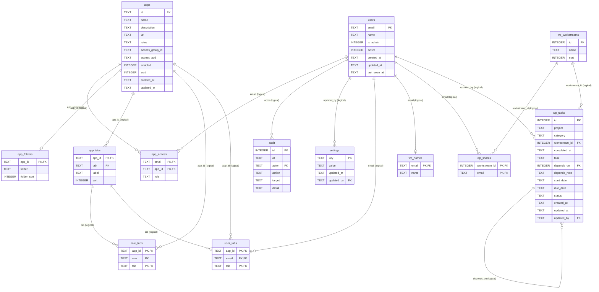

# FortifyGrid portal (website, sign-in, admin, Planner): schema and relationships

Generated by `npm run docs` from `schema.sql`. "logical" = the link is kept by code, not by a database constraint.

## app_access

Which apps each user may open, and their role there (one of the app's roles in apps.roles).  
Module **access** · Tier 1 · D1 (hot app state, roles, small tables) · key (email, app_id) · `schema.sql:24`

| Column | Type | Null | Default | Notes |
|---|---|---|---|---|
| email 🔑 | TEXT | no |  | → users.email (N:1, logical) |
| app_id 🔑 | TEXT | no |  | → apps.id (N:1, logical) |
| role | TEXT | no |  |  |

## app_folders

Dashboard folder (section) each app's tile sits in.  
Module **portal** · Tier 1 · D1 (hot app state, roles, small tables) · key (app_id) · `schema.sql:174`

| Column | Type | Null | Default | Notes |
|---|---|---|---|---|
| app_id 🔑 | TEXT | yes |  | → apps.id (1:1, logical) |
| folder | TEXT | no |  |  |
| folder_sort | INTEGER | no | 100 |  |

## app_tabs

Tabs each app has; its UI marks them data-tab="<tab>".  
Module **access** · Tier 1 · D1 (hot app state, roles, small tables) · key (app_id, tab) · `schema.sql:88`

| Column | Type | Null | Default | Notes |
|---|---|---|---|---|
| app_id 🔑 | TEXT | no |  | → apps.id (N:1, logical) |
| tab 🔑 | TEXT | no |  |  |
| label | TEXT | no |  |  |
| sort | INTEGER | no | 0 |  |

## apps

Registered apps: URL, roles (JSON, lowest first), Cloudflare Access group and audience.  
Module **access** · Tier 1 · D1 (hot app state, roles, small tables) · key (id) · `schema.sql:52`

| Column | Type | Null | Default | Notes |
|---|---|---|---|---|
| id 🔑 | TEXT | yes |  |  |
| name | TEXT | no |  |  |
| description | TEXT | no | '' |  |
| url | TEXT | no |  |  |
| roles | TEXT | no | '["viewer","admin"]' |  |
| access_group_id | TEXT | no | '' |  |
| access_aud | TEXT | no | '' |  |
| enabled | INTEGER | no | 1 |  |
| sort | INTEGER | no | 0 |  |
| created_at | TEXT | no |  |  |
| updated_at | TEXT | no |  |  |

## audit

Who changed what in admin (users, apps, tabs, settings, invites, sync). Append-only; newest 300 shown.  
Module **access** · Tier 1 · D1 (hot app state, roles, small tables) · key (id) · `schema.sql:36`

| Column | Type | Null | Default | Notes |
|---|---|---|---|---|
| id 🔑 | INTEGER | yes |  |  |
| at | TEXT | no |  |  |
| actor | TEXT | no |  | → users.email (N:1, logical) |
| action | TEXT | no |  |  |
| target | TEXT | no | '' |  |
| detail | TEXT | no | '' |  |

Indexes: `audit_at (at)`

## role_tabs

Which role may see which tab of an app.  
Module **access** · Tier 1 · D1 (hot app state, roles, small tables) · key (app_id, role, tab) · `schema.sql:101`

| Column | Type | Null | Default | Notes |
|---|---|---|---|---|
| app_id 🔑 | TEXT | no |  | → apps.id (N:1, logical) |
| role 🔑 | TEXT | no |  |  |
| tab 🔑 | TEXT | no |  | → app_tabs.tab (N:1, logical) |

## settings

Site config edited in admin → Settings (e.g. dashboard_notice banner).  
Module **portal** · Tier 1 · D1 (hot app state, roles, small tables) · key (key) · `schema.sql:75`

| Column | Type | Null | Default | Notes |
|---|---|---|---|---|
| key 🔑 | TEXT | yes |  |  |
| value | TEXT | no |  |  |
| updated_at | TEXT | no |  |  |
| updated_by | TEXT | no |  | → users.email (N:1, logical) |

## user_tabs

Extra tabs for one user on top of their role's tabs (Planner Admin tab edits these).  
Module **access** · Tier 1 · D1 (hot app state, roles, small tables) · key (app_id, email, tab) · `schema.sql:210`

| Column | Type | Null | Default | Notes |
|---|---|---|---|---|
| app_id 🔑 | TEXT | no |  | → apps.id (N:1, logical) |
| email 🔑 | TEXT | no |  | → users.email (N:1, logical) |
| tab 🔑 | TEXT | no |  | → app_tabs.tab (N:1, logical) |

## users

Every person who can sign in to the portal; is_admin = portal admin. Roles per app are in app_access.  
Module **access** · Tier 1 · D1 (hot app state, roles, small tables) · key (email) · `schema.sql:7`

| Column | Type | Null | Default | Notes |
|---|---|---|---|---|
| email 🔑 | TEXT | yes |  |  |
| name | TEXT | no | '' |  |
| is_admin | INTEGER | no | 0 |  |
| active | INTEGER | no | 1 |  |
| created_at | TEXT | no |  |  |
| updated_at | TEXT | no |  |  |
| last_seen_at | TEXT | yes |  |  |

## wp_names

Planner name per person; tasks whose Depends-on note names them show in their view.  
Module **planner** · Tier 1 · D1 (hot app state, roles, small tables) · key (email) · `schema.sql:282`

| Column | Type | Null | Default | Notes |
|---|---|---|---|---|
| email 🔑 | TEXT | yes |  | → users.email (1:1, logical) |
| name | TEXT | no |  |  |

## wp_shares

Workstreams shared with a member (they see, add and edit its tasks).  
Module **planner** · Tier 1 · D1 (hot app state, roles, small tables) · key (workstream_id, email) · `schema.sql:292`

| Column | Type | Null | Default | Notes |
|---|---|---|---|---|
| workstream_id 🔑 | INTEGER | no |  | → wp_workstreams.id (N:1, logical) |
| email 🔑 | TEXT | no |  | → users.email (N:1, logical) |

## wp_tasks

Planner tasks. Dates YYYY-MM-DD; complete tasks are deleted 30 days after completed_at.  
Module **planner** · Tier 1 · D1 (hot app state, roles, small tables) · key (id) · `schema.sql:243`

| Column | Type | Null | Default | Notes |
|---|---|---|---|---|
| id 🔑 | INTEGER | yes |  |  |
| project | TEXT | no | '' |  |
| category | TEXT | no | '' | existing DBs: run once  ALTER TABLE wp_tasks ADD COLUMN category TEXT NOT NULL DEFAULT ''; |
| workstream_id | INTEGER | yes |  | → wp_workstreams.id (N:1, logical) · wp_workstreams.id. Existing DBs: ALTER TABLE wp_tasks ADD COLUMN workstream_id INTEGER; |
| completed_at | TEXT | yes |  | set when status becomes complete; task is deleted 30 days later. Existing DBs: ALTER TABLE wp_tasks ADD COLUMN completed_at TEXT; |
| task | TEXT | no |  |  |
| depends_on | INTEGER | yes |  | → wp_tasks.id (N:1, logical) |
| depends_note | TEXT | no | '' |  |
| start_date | TEXT | yes |  |  |
| due_date | TEXT | yes |  |  |
| status | TEXT | no | 'not_started' |  |
| created_at | TEXT | no |  |  |
| updated_at | TEXT | no |  |  |
| updated_by | TEXT | no |  | → users.email (N:1, logical) |

## wp_workstreams

Planner workstreams (sub-tabs / channels). Edited in the Planner Admin tab.  
Module **planner** · Tier 1 · D1 (hot app state, roles, small tables) · key (id) · `schema.sql:265`

| Column | Type | Null | Default | Notes |
|---|---|---|---|---|
| id 🔑 | INTEGER | yes |  |  |
| name | TEXT | no |  |  |
| sort | INTEGER | no | 0 |  |
